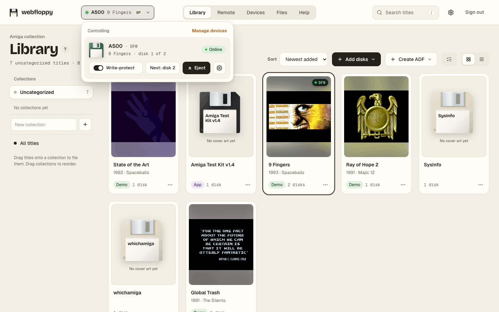
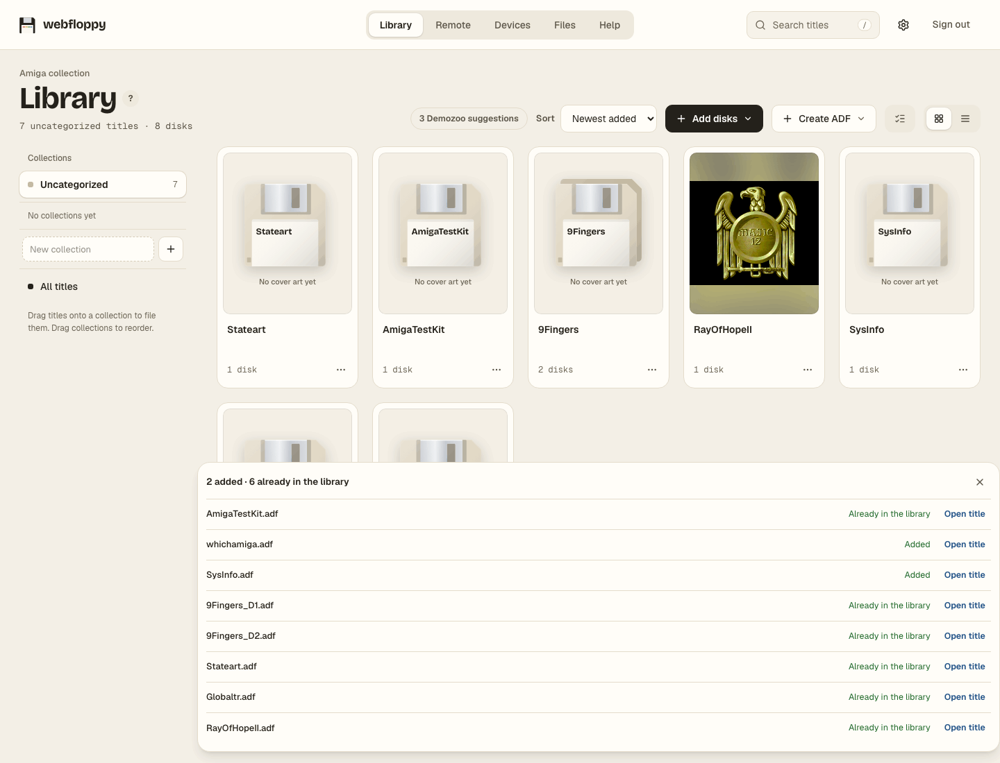
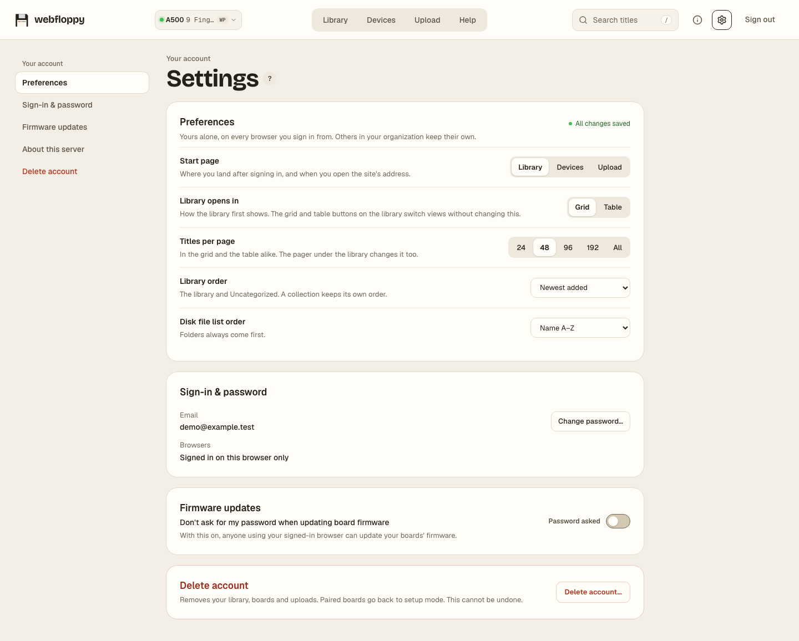
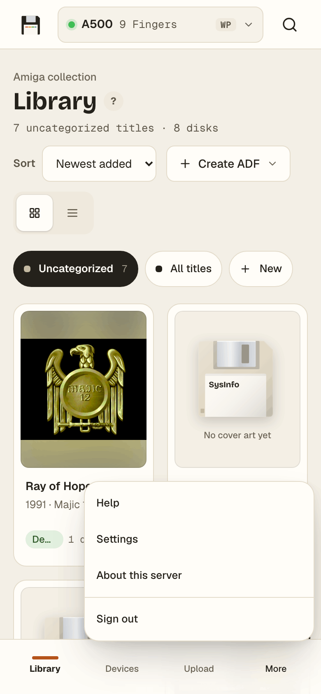
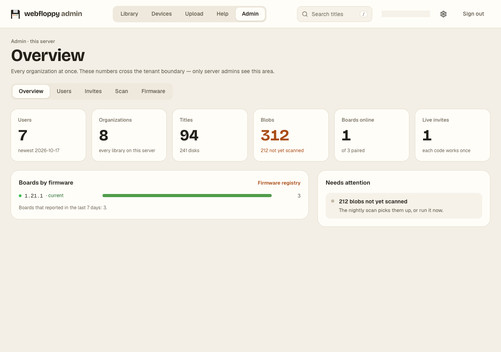

# WebFloppy

An Amiga disk library that puts a disk in a real Amiga's floppy drive over WiFi. (The repository keeps the
project's first name, `webadf`.)

Two halves that work together:

- **A web app** for keeping Amiga disk images. Add them, have them identified
  against TOSEC, OpenRetro and Demozoo, organise them into collections, browse and
  edit the files inside a disk, rewind a disk to any earlier version, and send files to
  and from the Amiga.
- **A drive replacement.** An RP2350 board plugs into the Amiga's floppy connector,
  behaves like a DD or HD floppy drive, and plays whichever disk you pick in the web app.
  When the Amiga saves, the changes go back to the library.

Run the web app two ways: use our hosted copy at <https://webadf.vercel.app> (on Vercel), or
host your own with Docker on any amd64 or arm64 machine, a NAS included. A self-hosted copy has every
feature the hosted one has. Firmware updates, the PaulaNET driver disk and the TOSEC catalogue
arrive by themselves; see [docs/self-hosting.md](docs/self-hosting.md).

Pick a disk in the browser, or tap its NFC tag on the drive, and the Amiga reads it.
Workbench 3.1 boots from the board, games load, and saves made on the Amiga show up
in the web app as new versions of the disk.


*Rev B, designed by Shanshe: 34-pin floppy header, floppy power connector, OLED
display, buzzer, a 4-pin header (J4), and a Pimoroni Pico Plus 2 W.
The KiCad project is in `wifi-floppy/hardware/`; check it with `pnpm hw:verify` before
ordering. Rev B has been the bench board since October 2026.*

## Bugs and ideas

Found a bug, or want something WebFloppy does not do yet? Anyone can open an issue at
<https://github.com/stefanskotte/webadf/issues>, for a bug report or a feature request alike. For a bug, say what
you did, what you saw and, for a board, which firmware it runs (Devices shows it).

## Quickstart

Choose where the web app runs. The board's first install is the same either way; only a
self-hosted copy needs one extra step, pointing the board at your server.

### Path A: the hosted web app (Vercel)

You need the board, a USB cable, a phone and an account on <https://webadf.vercel.app>
(registration is by invitation). The board talks to this server out of the box.

1. Hold the **BOOT** button (the Raspberry Pi docs call it BOOTSEL) and plug the board into
   your computer over USB. A drive called `RP2350` appears.
2. Download `wifi-floppy-install-<version>.uf2` from the
   [latest release](https://github.com/stefanskotte/webadf/releases/latest) and drag it onto
   that drive. The board writes it and restarts by itself; the drive disappears.
3. In the web app, open **Devices**, press **Pair a device**, give the board a name and press
   **Get a code** (the code lasts 10 minutes). On your phone, join the board's setup Wi-Fi, `wifi-floppy-XXXX` (password
   `wififloppy`). The setup page opens by itself, or browse to `http://192.168.4.1/`. Enter
   your Wi-Fi network, its password and the code.
4. Done. The board joins your network and appears under Devices. Firmware updates now arrive
   over the air from the web app.

### Path B: your own server (self-hosted, Docker)

You need a host with Docker and Compose v2, the board, a USB cable and a phone.

1. Install the stack, as [docs/self-hosting.md](docs/self-hosting.md#2-install) describes: download
   `compose.yaml` and `.env.example` (as `.env`) from the newest `web-X.Y.Z` tag, set `WEBADF_URL`
   (for example `https://192.168.1.10`) and `WEBADF_ADMIN_EMAIL` in `.env`, then run
   `docker compose up -d`. Create the account with the link from `docker compose logs app | grep 'first admin'`.
2. Install the firmware as in steps 1-2 of Path A.
3. **Override the server.** The firmware points at the hosted app by default. Open the board's
   USB serial console (any serial terminal, firmware 1.13.0 or newer) and type:

   ```
   wf server set https://192.168.1.10
   wf server tls noverify
   YES
   wf reboot
   ```

   Use your own `WEBADF_URL`. `tls noverify` is needed because a board cannot trust the
   certificate Caddy makes for an IP address or a LAN name; with a public `WEBADF_DOMAIN` and a
   Let's Encrypt certificate, leave it out. `wf server show` prints the setting and
   `wf server clear` goes back to the hosted app. Changing the server forgets the board's
   Wi-Fi and pairing, and it refuses while a disk is mounted.
4. Pair it as in step 3 of Path A, from **Devices** on your own server. Firmware updates come
   from your server too: it imports every signed release from GitHub daily.

If your phone has joined this board's setup network before, forget that network first. More
detail, and what to do when a join fails, is in
[wifi-floppy/README.md](wifi-floppy/README.md#first-install) and, for a self-hosted copy,
[docs/self-hosting.md](docs/self-hosting.md#4-boards).

## Screenshots

The pictures come from a demo account holding freely redistributable disks: scene demos and
freeware tools. `PORT=3100 pnpm screenshots` takes them again (see
`e2e/screenshots.shots.ts`); every email address on them is masked, and the board is a
stand-in called A500.


*The library. Titles are identified against TOSEC and Demozoo; the 9 Fingers card is
outlined and carries a DF0 pill because its disk is in a drive.*



*The drive menu in the header: from any page, see what each board is playing, switch write
protection, step to the next disk or eject.*


*A title page: facts and screenshots from Demozoo, then each disk with its actions.*


*Files: two panes, as in a Workbench file manager, over STASH:, NET: and LIBRARY:. Each edit to a disk is a new
version in its History.*


*A board on the Devices page. The drawing's screen shows what the board's OLED shows.*


*The display editor: choose the panel, then which elements the OLED draws and where.*



*Adding disks: drop them anywhere on the Library page, or use Add disks (Browse files, Paste a URL). The tray says
what each one did.*


*Help explains the parts that are not obvious.*



*Settings, About this server included.*

 

*On a phone or a tablet (below 1024 px wide), the pages move to a tab bar at the bottom; More holds the rest.*



*The server admin's Overview, for whoever runs the copy.*

## Features

### Library

- Add `.adf`, `.adz`, `.dms`, `.dmz` and `.hfe` by dropping them anywhere on the Library page (folders and
  `.zip` / `.lha` of them too) or through Add disks: Browse files, or Paste a URL to one (or to a `.zip` or `.lha`
  of them, up to 20 MB). Drop `.lha`, `.lzh` and `.zip` archives onto a disk to pick files out of them.
- HD (1.76 MB) ADFs are recognised and tagged HD, and are disks like any other: browsed
  and edited in the browser, with full history.
- Each unique disk is stored once, however many times it is added.
- Disks are identified against TOSEC, OpenRetro and Demozoo, and grouped into titles
  with cover art, screenshots, publisher, year and type.
- A grid of cards or a condensed table, a page at a time; collections (folders in the table),
  disk sets for multi-disk games, and search from the header.
- Create a blank formatted disk: 880 KB or 1.76 MB, OFS or FFS.
- Download any disk as an ADF.
- Works on a phone: below 1024 px the pages move to a tab bar at the bottom.

### Files

- The Files page: two panes over three places. LIBRARY: holds your titles and their disks; STASH: keeps loose
  files for 30 days (what you drop there, and what your Amiga sends); NET: holds what waits to go to each board's
  Amiga. Copy and move between the panes, or drag.
- Browse the AmigaDOS filesystem in the browser: files, folders, free space.
- Add, rename, move and delete files and folders; drop a folder from your computer
  onto a disk; drag entries between folders.
- Every change is a new version. The history panel shows what changed in each
  version, lets you browse any old version, and restores one as a new version.
- HFE images (including long-track formats such as Turrican's) play read-only and can
  be extracted to an ADF when every sector decodes.

### The drive

- Set up from a phone: the board opens a WiFi setup page, you enter your network and
  a pairing code from the web app, and it joins your library.
- Mount and eject from the web app, from the drive menu in the header, or by
  tapping an NFC tag. Next disk steps a multi-disk game on, and the board loads that disk
  ahead of time.
- Reads and writes on a real Amiga. Saves reach the library as new disk versions,
  including saves made while the board was offline.
- Works as DF0, beside a real DF1. Or the board is DF1 as well: holding the next disk of the
  set, or any disk you mount there.
- Plays HD disks: the board tells the Amiga it is an HD drive while an HD disk is in.
  Needs Kickstart 3.0 or later. Playing needs firmware 1.4.1 or later (the web app
  refuses to mount an HD disk on older firmware and says so); saving to an HD disk
  needs 1.5.0 (1.4.x keeps HD write-protected on the board whatever the web app
  says).
- Write protection can be switched from the web app while the disk is in the drive.
- OLED status display (128x32 or 128x64, SSD1306 or SH1106): WiFi strength, what it is
  doing, the disk's name and the current track. A display editor in the web app picks what
  it shows and where. An activity LED blinks on reads.
- Updates its own firmware from the web app. Releases are signed, a failed update
  falls back to the previous firmware, and the board never updates while a disk is
  in the drive.

### Amiga networking

- The board can put the Amiga on your network as DF1, with Rob Smith's PaulaNET driver
  (used with his permission) and a TCP/IP stack such as AmiTCP_NG or Roadshow. The driver disk
  comes from the board itself.
- Send files from your computer, or from a disk in your library, to a folder on the Amiga: on the Files page,
  drop them on Send files to the Amiga, or copy them into a board under NET:. Files the Amiga sends back land in STASH:.

### NFC tags

- Tap a tag on the drive to mount its disk. Tapping another tag swaps disks; tapping
  the one already in the drive does nothing. A Next-disk card steps to the next disk.
- Write any disk to a tag from the ⋯ menu on its library card, or the NFC button on a
  disk, then tap a tag on the drive; the result appears in the browser.
- A tag only ever mounts disks from your own library.
- Reader: HW-147C (Si512), on the board's I2C bus next to the OLED. PN532 modules work
  from firmware 1.18.0 and are still being tested.

## How it works

An Amiga floppy drive does not deliver blocks. It hands Paula a raw magnetic flux
stream and the Amiga decodes MFM in software, so a drive emulator has to produce flux
at the right rate, continuously, while the disk spins.

```
  browser  ──mount──▶  web app  ──encodes ADF → MFM──▶  device  ──flux──▶  Amiga
     ▲                    │                                │
     └──── new version ◀──┴── Postgres + blobs     RP2350 + 8 MB PSRAM ◀── NFC tag
```

The server encodes a 901,120-byte ADF into 2,027,536 bytes of Amiga MFM and the board
streams it: PIO emits 2 µs bitcells, DMA restarts each revolution and raises INDEX,
giving 300 rpm. The whole disk lives in PSRAM, so a seek is answered immediately
instead of over the network. The board streams flux rather than ADFs, which lets
flux formats such as HFE use the same path.

An HD disk is the exception. The server sends the board the ADF itself (a small
WFAD header, then 1,802,240 bytes), and the board encodes each track to MFM as the
head reaches it, in about 4 ms, well inside the head's settle time. A PIO program
answers the Amiga's drive-ID read on RDY with the HD ID while an HD disk is mounted.
When the Amiga saves to an HD disk, the board checks all 22 sectors of the written
track, keeps them as ADF bytes, and uploads those bytes as they are.

When the Amiga writes, the board decodes the written tracks, uploads them, and the
server records them as a new version of the disk. Versions are stored as sector
deltas.

## Status

| | |
|---|---|
| Web app: library, collections, identification, search | live |
| Add `.adf` `.adz` `.dms` `.hfe` to the library; `.lha`/`.lzh`/`.zip` onto a disk | live |
| File editing inside a disk, blank disks, drag and drop | live |
| Disk history: browse and restore any version | live, restore verified on hardware |
| Device: setup portal, WiFi, TLS, pairing | verified on hardware |
| Mount and eject from the browser and the header's drive menu | verified on hardware |
| Reading on a real Amiga (Workbench 3.1, games) | verified on hardware |
| Writing on a real Amiga, saves reach the library | verified on hardware |
| Second drive (DF1) alongside the board | verified on hardware |
| HFE, including long-track (Turrican) | verified on hardware; weak-bit titles not yet tested |
| HD disks, read-only (Kickstart 3.0+) | verified on hardware (firmware 1.4.1, Kickstart 3.1) |
| HD disks: Amiga saves, history, browser editing, blank HD disks | shipped in firmware 1.5.1; bench steps 4-7 owed (HANDOFF 3ao) |
| Firmware updates from the web app | verified on hardware (current release: 1.21.1) |
| Self-hosting with Docker (compose stack, GHCR image, amd64 + arm64) | live (web-1.1.0); verified with a board and an A500 on an openmediavault NAS |
| NFC: tap to mount, write tags from the web | verified on hardware |
| Amiga networking (PaulaNET as DF1), files to and from the Amiga | verified on hardware (A500) |
| Rev B board | built and running (Shanshe's design, `wifi-floppy/hardware/`) |

## Repository

| Path | What |
|---|---|
| `src/` | the Next.js app |
| `src/lib/adfmfm/` | ADF ⇄ Amiga MFM encoder, verified against Greaseweazle |
| `src/lib/adffs/` | AmigaDOS filesystem reader/writer (OFS/FFS) |
| `src/lib/archive/` | `.lha`/`.lzh`, `.zip` and `.dms` decoders, all browser-side |
| `src/lib/hfe/` | HFE parsing, conversion for the board, ADF extraction |
| `src/lib/disk-history/` | sector deltas and the version chain behind history and restore |
| `src/lib/nfc/` | NFC tap and tag-writing rules and storage |
| `wifi-floppy/firmware/` | the RP2350 firmware (pico-sdk ≥ 2.3.0) |
| `wifi-floppy/hardware/` | the board (KiCad) |
| `docs/superpowers/specs/` | design specs, one per feature |
| `HANDOFF.md` | the engineering log: decisions, measurements, bench results |

## Running it

```bash
pnpm install
pnpm db:dev start         # a local Postgres 18 in Docker; prints its DATABASE_URL
pnpm db:migrate           # apply drizzle/ to DATABASE_URL (there is no db:push)
pnpm dev                  # needs .env.local: DATABASE_URL, BETTER_AUTH_SECRET,
                          # BETTER_AUTH_URL (BLOB_READ_WRITE_TOKEN is optional)
pnpm test                 # vitest, pure logic
pnpm e2e                  # playwright, against the database in .env.local
bash scripts/e2e-local.sh # playwright with no Vercel or Neon: a fresh Postgres in
                          # its own container (webadf-pg-e2e, :55433 -- never the
                          # db:dev one) and local storage; arguments go to playwright
```

Stored files (disk images, covers, firmware) go to local disk under `./data/blobs`
(`STORAGE_DIR` moves it) unless `BLOB_READ_WRITE_TOKEN` is set, in which case they go to
Vercel Blob. On Vercel the token is required: the app refuses to fall back to local disk there.

To run your own copy, use the Docker stack in [docs/self-hosting.md](docs/self-hosting.md)
(Quickstart, [Path B](#path-b-your-own-server-self-hosted-docker)); the commands above are for development.

A self-hosted copy needs no extra setting: Settings → About this server (`/about` leads there) reads
**Self-hosted** unless `SELFHOSTED=false`, which only our own deployment sets. A Docker build
without `.git` can pass `GIT_SHA` so About this server shows the commit.

Firmware:

```bash
export PICO_SDK_PATH=/path/to/pico-sdk        # tag 2.3.0 or later
pnpm firmware:build
pnpm firmware:test                            # host tests, no board needed
pnpm firmware:publish --dry-run               # sign and register a release
```

Write a disk to an NFC tag from the command line:

```bash
pnpm nfc:write "Turrican II disk 1"           # then tap a tag on the drive
```

The setup access point uses the password **`wififloppy`** by default. Set
`PORTAL_AP_PASSWORD` at build time to change it. The pairing code from the web app is
what authorises a board to join a library.

Putting the firmware on a new board is the [Quickstart](#quickstart) above: one
`wifi-floppy-install-<version>.uf2` from the GitHub release, dragged onto the drive that
appears while BOOT is held at power-up. With picotool, `pnpm firmware:install-partitioned` still works.

Every push that touches the firmware is built by
[`.github/workflows/firmware.yml`](.github/workflows/firmware.yml), which runs the host
tests and publishes a `.uf2` with a `manifest.json` (version, commit, size, SHA-256).

## Verification

Each layer that talks to hardware or to an undocumented format is checked against an
independent implementation:

| | checked against |
|---|---|
| `pnpm adfmfm:diff` | Greaseweazle's `amigados` codec |
| `pnpm adffs:verify` | `xdftool` |
| `pnpm lha:verify` | the real `lha` binary |
| `pnpm dms:verify` | xDMS, the implementation ours was ported from |

## Licence

- **Software** (the web app, scripts and the wifi-floppy firmware source): [MIT](LICENSE).
- **Hardware** (`wifi-floppy/hardware/`, the board design): [CERN-OHL-P-2.0](wifi-floppy/hardware/LICENSE), the
  permissive open-hardware licence, so anyone can build, modify and sell their own boards. The rev B PCB layout is
  Shanshe's work, licensed this way with Shanshe's agreement; see
  [wifi-floppy/hardware/NOTICE.md](wifi-floppy/hardware/NOTICE.md).
- **Third-party code, the libraries in the firmware image, and acknowledgements**: see
  [THIRD-PARTY-NOTICES.md](THIRD-PARTY-NOTICES.md). The Wi-Fi driver bundled with the Pico SDK is licensed for use
  on Raspberry Pi chips (which this board is).

This project builds on Nano-Tek, OpenFlops, Keir Fraser's FlashFloppy and Greaseweazle, and the other work credited
in the notices file.
